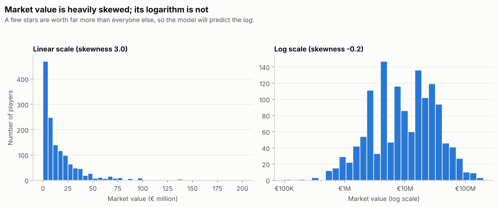
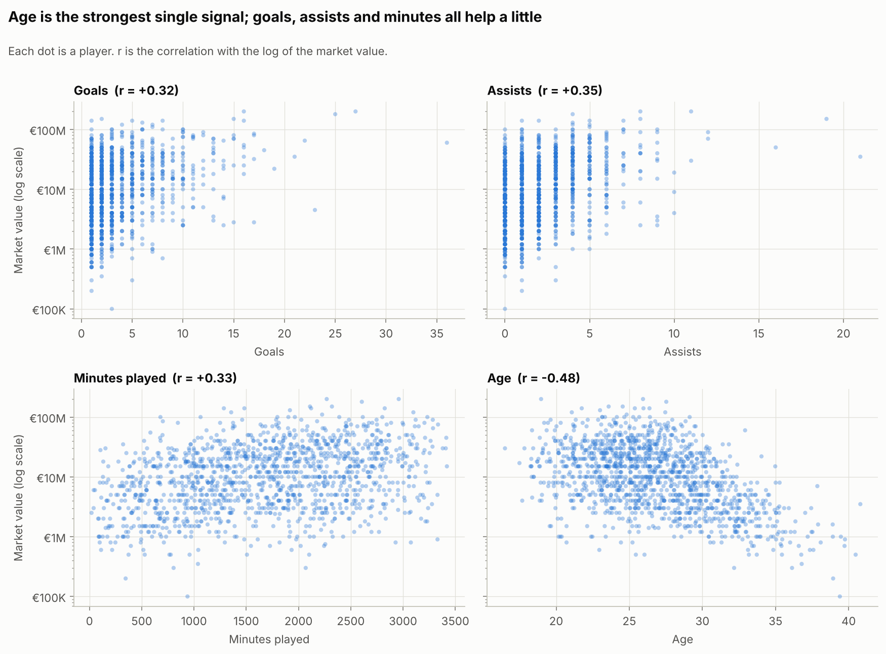
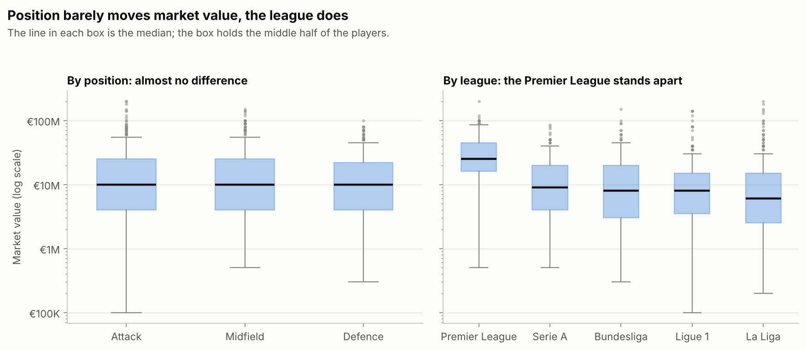
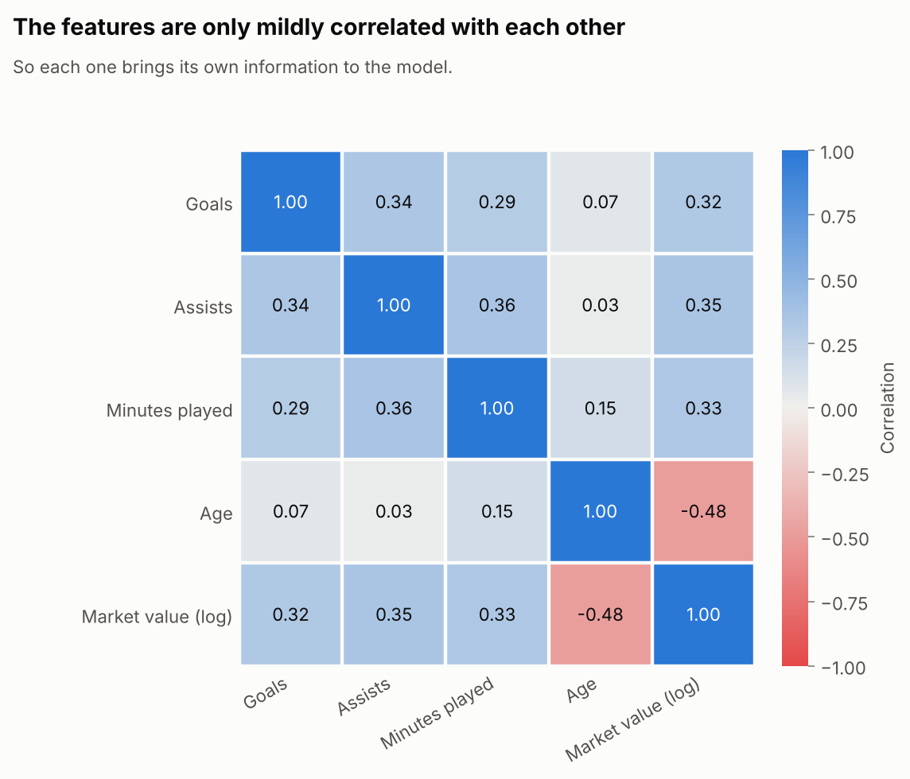

# Football Players Market Value Predictor

Can a few simple statistics explain how much a football player is worth?

This project trains a **linear regression** model that predicts a player's
market value from their performance and profile, then compares the prediction
with the player's actual market value to spot who looks over- or under-valued.

> **Status:** work in progress. The project skeleton is in place; data
> collection, modelling and results are being added step by step (see the
> [roadmap](#roadmap)).

## Approach

| | |
|---|---|
| **Features** | goals, assists, minutes played, age, position |
| **Target** | market value (EUR) |
| **Model** | linear regression (scikit-learn) |
| **Scope** | top 5 European leagues, 2025-26 season |
| **Stack** | Python, pandas, scikit-learn, matplotlib |

An LLM is used on top of the model to turn its numbers into short, readable
scouting reports. It only comments on the model's output; it never makes the
prediction itself.

## Data sources

- **[football-data.org](https://www.football-data.org/)** (free plan): goals,
  assists, date of birth and position. The API only lists players who scored
  at least one goal in the season, so the dataset is limited to those players.
- **[Transfermarkt public dataset](https://github.com/dcaribou/transfermarkt-datasets)**:
  market value and minutes played, which the free plan of football-data.org
  does not provide. The market value is each player's latest valuation at the
  end of the season.

The two sources share no identifier, so players are matched on their name and
date of birth, among the players who appeared in the same league. About 99% of
the players are matched; the others are listed in a report instead of being
dropped silently.

## Project structure

```
├── src/football_value/   # Python package (config, data, features, model, ...)
├── tests/                # Unit tests
├── data/
│   ├── raw/              # Cached API responses and downloads (not versioned)
│   └── processed/        # Cleaned, model-ready datasets (not versioned)
├── reports/figures/      # Charts produced by the pipeline (versioned)
├── .env.example          # Template for the required environment variables
├── requirements.txt      # Pinned runtime dependencies
└── pyproject.toml        # Package metadata and tool configuration
```

## Getting started

Requires Python 3.11 or newer.

```bash
git clone https://github.com/Ofilhi/football-market-value-ml.git
cd football-market-value-ml

python -m venv .venv
source .venv/bin/activate        # Windows: .venv\Scripts\activate

pip install -r requirements-dev.txt
pip install -e .
```

Then create your own `.env` file:

```bash
cp .env.example .env
```

| Variable | Purpose |
|---|---|
| `FOOTBALL_DATA_API_KEY` | football-data.org token ([free registration](https://www.football-data.org/client/register)) |
| `RESPAN_API_KEY` | key for the LLM gateway |
| `LLM_BASE_URL` | OpenAI-compatible endpoint of the LLM gateway |
| `LLM_MODEL` | model used for the scouting reports |

The `.env` file is ignored by git, so your keys never leave your machine.

## Usage

Collect the players' statistics from football-data.org:

```bash
python -m football_value.collect
```

This sends one request per league, caches the raw responses in
`data/raw/football_data/` and writes `data/raw/football_data_players.csv`.
Running it again reads the cache instead of calling the API.

Then add the market values and minutes played from the Transfermarkt dataset:

```bash
python -m football_value.merge
```

This downloads the dataset once into `data/raw/transfermarkt/` (about 55 MB)
and writes `data/processed/players_merged.csv`, plus
`data/processed/unmatched_players.csv` for the players that could not be matched.

Finally, clean the data and build the model-ready dataset:

```bash
python -m football_value.features
```

This writes `data/processed/players_features.csv`, with one row per player:
the five features and the market value. The cleaning steps are:

- missing assists are set to 0 (the API leaves the field empty instead of 0);
- positions are grouped into Attack, Midfield and Defence;
- players whose market value was last updated before the season are removed;
- a player who changed league mid-season gets a single row with summed statistics;
- age is computed at the end of the season.

Explore the data and produce the charts shown below:

```bash
python -m football_value.eda
```

## Exploratory analysis

The dataset holds **1,366 players** from the top 5 European leagues.

**1. The target is heavily skewed.** Half of the players are worth less than
€10M while a few stars reach €200M. On a log scale the distribution becomes
almost symmetric (skewness 3.0 → -0.2), so the model predicts the logarithm of
the market value.



**2. Age is the strongest single signal.** Value stays high until about 27
and then drops steadily. Goals, assists and minutes each have a moderate
positive link with value.



**3. Position barely matters, the league does.** The three positions share the
same median value (€10M). The league is not one of the model's features, yet
the median Premier League player is worth €25M against €6M to €9M elsewhere:
a known blind spot of this model.



**4. The features are only mildly correlated with each other** (0.36 at most),
so the regression coefficients can be interpreted without much trouble.



## Model and results

Train and evaluate the models:

```bash
python -m football_value.model
```

**Method**

- The players are split once into a training set (80%, 1,092 players) and a
  test set (20%, 274 players) with a fixed random seed. All the numbers below
  are measured on the test set, which the models never saw.
- The model predicts the logarithm of the market value; predictions are
  converted back to euros before the errors are measured.
- Numeric features are standardised and the position is one-hot encoded
  inside a scikit-learn pipeline, so the preprocessing is learned from the
  training set only (no data leakage).
- Three models are compared: a **baseline** that gives every player the same
  typical value, the **linear** regression on the five features, and an
  **extended** variant that adds the league and age squared.

**Results on the test set**

| Model | Typical error (% of real value) | MAE | RMSE | R² (log scale) |
|---|---|---|---|---|
| Baseline | 73% | €15.6M | €28.9M | 0.00 |
| **Linear (5 features)** | **63%** | **€11.5M** | **€20.5M** | **0.49** |
| Extended (+ league, age²) | 49% | €11.1M | €30.9M | 0.63 |

Five simple statistics explain about half of the differences in (log) market
value. That is a real signal, but far from a pricing tool: the typical
prediction is still off by 63% of the player's real value.

Adding the league and age squared helps most players (typical error down to
49%), but the RMSE gets worse. One prediction is responsible: the extended
model values Erling Haaland at about €600M instead of €200M. A model trained
on logarithms multiplies its effects, so a player who is extreme on several
features at once gets an explosive prediction once converted back to euros.

**What drives the value** (linear model)

| Feature | Effect on market value |
|---|---|
| Age | -48% for 4.2 more years |
| Goals | +38% for 3.5 more goals |
| Minutes played | +35% for 806 more minutes |
| Assists | +29% for 2.2 more assists |
| Defender | +27% compared with an attacker with the same statistics |
| Midfielder | +26% compared with an attacker with the same statistics |

Numeric effects are given for one standard deviation of the feature, which
makes them comparable: age weighs more than any performance statistic. The
position effect is a reminder of how coefficients read: a defender is not
worth more than an attacker in general, but a defender who scores and assists
as much as an attacker is.

The full tables are in [`reports/metrics.csv`](reports/metrics.csv) and
[`reports/coefficients.csv`](reports/coefficients.csv).

## Development

```bash
pytest          # run the tests
ruff check .    # lint
```

## Roadmap

- [x] Project skeleton, configuration and tooling
- [x] Data collection from football-data.org (with local cache and rate limiting)
- [x] Market values and minutes from the Transfermarkt dataset, joined to the API data
- [x] Cleaning and feature engineering
- [x] Exploratory data analysis
- [x] Linear regression: training and evaluation against a baseline
- [ ] Visualisations: predicted vs actual value, residuals, over/under-valued players
- [ ] LLM scouting reports
- [ ] Results, limitations and possible improvements
