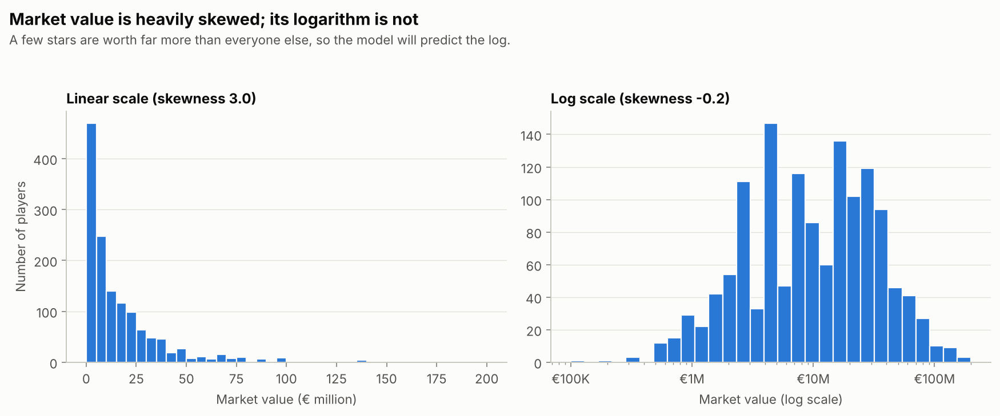
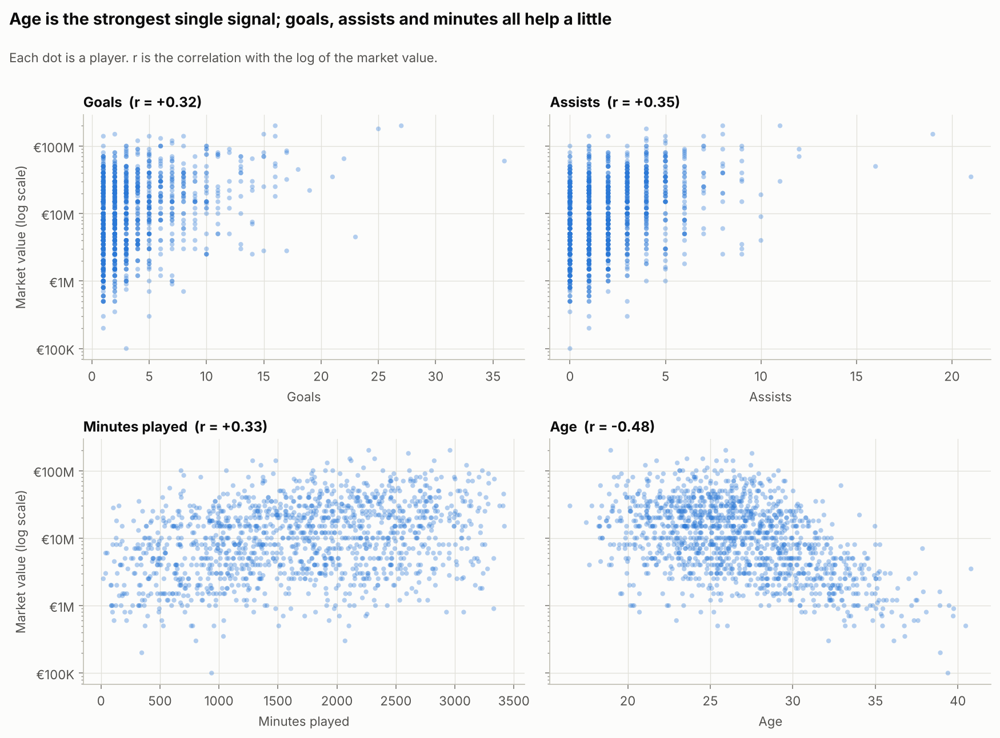
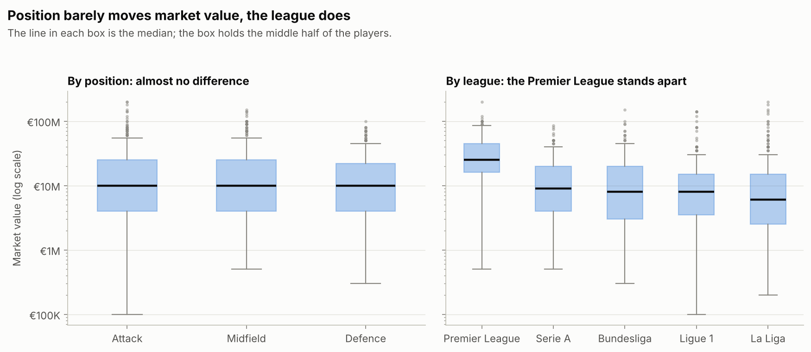
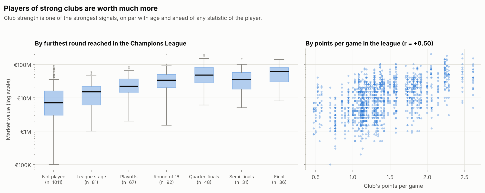
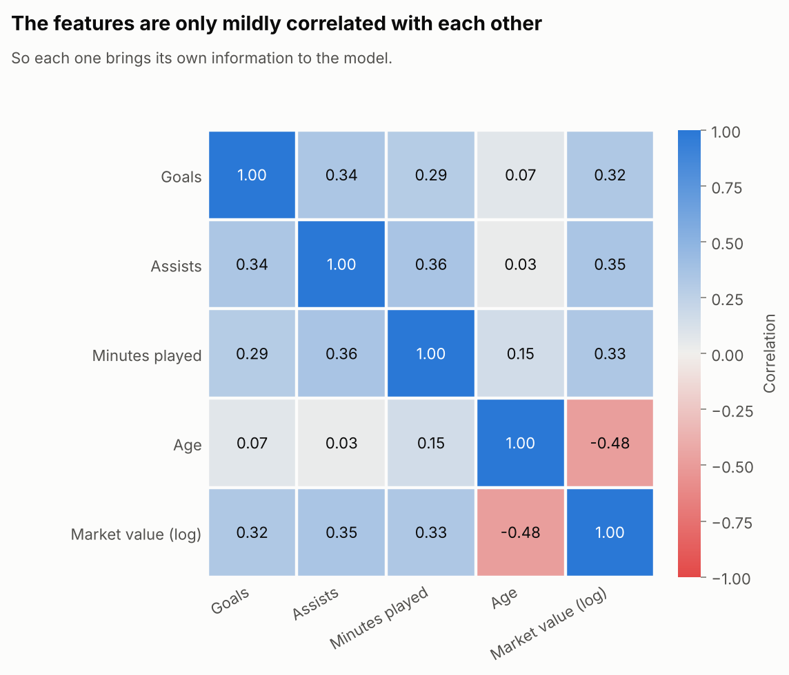
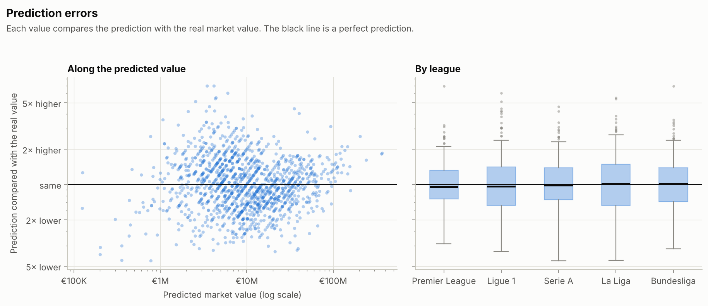
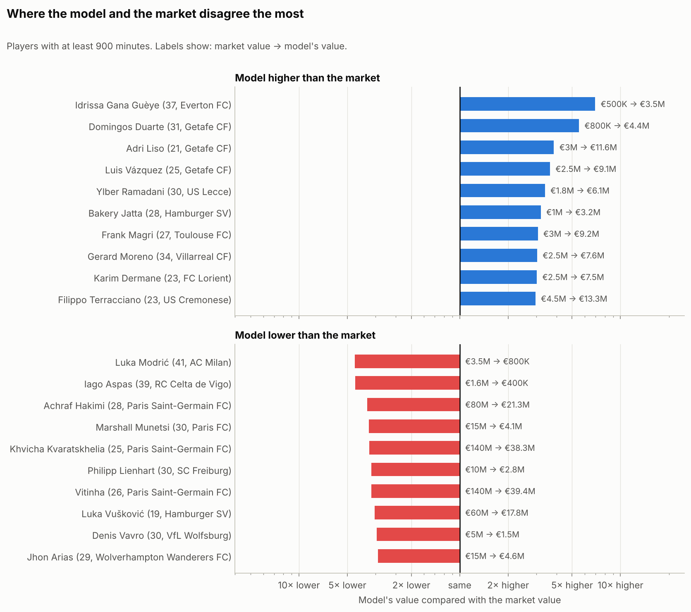

# Football Players Market Value Predictor

Can a few statistics explain how much a football player is worth?

This project trains a **linear regression** model that predicts a player's
market value from his performance, his profile and the strength of his club,
then compares the prediction with the player's actual market value to spot who
looks over- or under-valued.

**Result in one line:** goals, assists, minutes, age and position alone leave a
typical error of 63% on the test set (56% by cross-validation). Adding the
league and the strength of the player's club (league table, Champions League),
all from football-data.org, brings it down to **33%**, and the explained share
of the (log) market value from 0.49 to 0.86. The typical error is now the same
for every position (about 33%, against 54% to 59% before), but for defenders
this is only because the model sees their club, not their defending: see
[Limitations](#limitations).

**Contents:** [Data](#data-sources) · [Quick start](#getting-started) ·
[Exploratory analysis](#exploratory-analysis) · [Model and results](#model-and-results) ·
[Predicted vs actual](#predicted-vs-actual-value) · [LLM reports](#llm-scouting-reports) ·
[Limitations](#limitations) · [Possible improvements](#possible-improvements)

## Approach

| | |
|---|---|
| **Target** | market value (EUR), predicted on a log scale |
| **Original features** | goals, assists, minutes played, age, position |
| **Added factors** | league; strength of the player's team (league table, Champions League); matches played; a curved age effect |
| **Main model** | Ridge regression (a linear regression with a penalty on large coefficients) |
| **Reference model** | plain linear regression on the five original features |
| **Scope** | top 5 European leagues, 2025-26 season |
| **Stack** | Python, pandas, scikit-learn, matplotlib |

The project started from the five player-level features. They explain only
about half of the variation of the (log) market value, so the main model adds
factors that football-data.org also provides, chosen by cross-validation (see
[Which factors help](#model-and-results)). The five-feature model is kept as the
reference to show what they bring.

An LLM is used on top of the model to turn its numbers into short, readable
scouting reports. It only comments on the model's output; it never makes the
prediction itself.

## Data sources

- **[football-data.org](https://www.football-data.org/)** (free plan):
  - for each player: goals, assists, matches played, date of birth and position.
    The API only lists players who scored at least one goal in the season, so
    the dataset is limited to those players;
  - for each team: the league table, the league match results and the
    Champions League matches, which measure the strength of the club.
- **[Transfermarkt public dataset](https://github.com/dcaribou/transfermarkt-datasets)**:
  the market value and the minutes played, which the free plan of
  football-data.org does not provide. The market value is each player's latest
  valuation at the end of the season. It also provides optional extra factors
  (career history, the club's European games, contract, international caps) used
  by one comparison model.

The two sources share no identifier, so players are matched on their name and
date of birth, among the players who appeared in the same league. About 99% of
the players are matched; the others are listed in a report instead of being
dropped silently.

## Project structure

```
├── src/football_value/
│   ├── config.py                # Paths, constants, settings read from .env
│   ├── football_data_client.py  # API client: disk cache + rate limiting
│   ├── collect.py               # 1. player statistics from football-data.org
│   ├── teams.py                 # 2. league table, results, Champions League
│   ├── transfermarkt.py         #    Transfermarkt loading and extra factors
│   ├── matching.py              #    player matching across the two sources
│   ├── merge.py                 # 3. join the two sources
│   ├── features.py              # 4. cleaning and feature engineering
│   ├── eda.py                   # 5. exploratory charts
│   ├── model.py                 # 6. training, evaluation, predictions
│   ├── visualize.py             # 7. result charts
│   ├── pipeline.py              # runs steps 1 to 7
│   ├── scouting.py              # LLM scouting reports (optional)
│   └── plotting.py              # shared chart style
├── tests/                       # Unit tests (no network needed)
├── data/
│   ├── raw/                     # Cached API responses and downloads (not versioned)
│   └── processed/               # Cleaned datasets and predictions (not versioned)
├── reports/
│   ├── figures/                 # Charts (versioned)
│   ├── metrics.csv              # Test and cross-validation metrics of every model
│   ├── errors_by_position.csv   # Cross-validated error by position
│   └── coefficients.csv         # Coefficients of the main model
├── .env.example                 # Template for the required environment variables
├── requirements.txt             # Pinned runtime dependencies
└── pyproject.toml               # Package metadata and tool configuration
```

## Getting started

Requires Python 3.11 or newer.

```bash
git clone https://github.com/Ofilhi/football-market-value-ml.git
cd football-market-value-ml

python -m venv .venv
source .venv/bin/activate        # Windows: .venv\Scripts\activate

pip install -r requirements-dev.txt
pip install -e .
```

Then create your own `.env` file:

```bash
cp .env.example .env
```

| Variable | Purpose |
|---|---|
| `FOOTBALL_DATA_API_KEY` | football-data.org token ([free registration](https://www.football-data.org/client/register)) |
| `LLM_API_KEY` | key of the LLM provider |
| `LLM_BASE_URL` | OpenAI-compatible endpoint of the LLM provider |
| `LLM_MODEL` | model used for the scouting reports |

The `.env` file is ignored by git, so your keys never leave your machine. Only
`FOOTBALL_DATA_API_KEY` is needed to run the pipeline; the LLM variables are
only for the scouting reports.

## Usage

Run the whole pipeline (steps 1 to 7 below) with one command:

```bash
python -m football_value.pipeline
```

The first run is slower (it downloads about 55 MB and respects the API rate
limit of 10 requests per minute); the next ones take about fifteen seconds
because everything is cached. The results are reproducible: the random seed is
fixed, and a second run gives exactly the same metrics and charts.

Or run the steps one by one, to see what each of them does.

**1. Collect** the players' statistics from football-data.org:

```bash
python -m football_value.collect
```

This sends one request per league, caches the raw responses in
`data/raw/football_data/` and writes `data/raw/football_data_players.csv`.
Running it again reads the cache instead of calling the API.

**2. Collect the team factors** (league table, results, Champions League):

```bash
python -m football_value.teams
```

This writes `data/raw/football_data_teams.csv`, one row per team (96 teams, 11
more requests, also cached).

**3. Merge** the market values, minutes played and extra factors from the
Transfermarkt dataset:

```bash
python -m football_value.merge
```

This downloads the dataset once into `data/raw/transfermarkt/` and writes
`data/processed/players_merged.csv`, plus `data/processed/unmatched_players.csv`
for the players that could not be matched.

**4. Clean** the data and build the model-ready dataset:

```bash
python -m football_value.features
```

This writes `data/processed/players_features.csv`, with one row per player: all
the candidate factors and the market value. The cleaning steps are:

- missing assists are set to 0 (the API leaves the field empty instead of 0);
- positions are grouped into Attack, Midfield and Defence;
- players whose market value was last updated before the season are removed;
- a player who changed league mid-season gets a single row with summed statistics
  and the factors of the team where he played the most;
- age is computed at the end of the season; the team's factors and the player's
  share of his team's matches are added.

**5. Explore** the data and produce the charts shown below:

```bash
python -m football_value.eda
```

## Exploratory analysis

The dataset holds **1,366 players** from the top 5 European leagues.

**1. The target is heavily skewed.** Half of the players are worth less than
€10M while a few stars reach €200M. On a log scale the distribution becomes
almost symmetric (skewness 3.0 → -0.2), so the model predicts the logarithm of
the market value.



**2. Age is the strongest player-level signal.** Value stays high until about 27
and then drops steadily. Goals, assists and minutes each have a moderate
positive link with value.



**3. Position barely matters, the league does.** The three positions share the
same median value (€10M), while the median Premier League player is worth €25M
against €6M to €9M elsewhere.



**4. The strength of the club matters as much as age.** The more successful a
club is, the more its players are worth: from a median of €7M for clubs outside
the Champions League to €60M for the finalists. Points per game in the league
correlate with the log market value at +0.50, more than any player statistic.
This is what the added factors capture.



**5. The player features are only mildly correlated with each other** (0.36 at
most).



## Model and results

**6. Train and evaluate** the models:

```bash
python -m football_value.model
```

**Method**

- The players are split once into a training set (80%, 1,092 players) and a
  test set (20%, 274 players) with a fixed random seed. Test figures are
  measured on players the models never saw. Because 274 players give a noisy
  picture, every model is also **cross-validated** on all the players (5 folds,
  repeated 3 times): each player is predicted by a model that never saw him.
- The model predicts the logarithm of the market value; predictions are
  converted back to euros before the errors are measured.
- Numbers are standardised and the position and league are one-hot encoded
  inside a scikit-learn pipeline, so the preprocessing is learned from the
  training data only (no data leakage).
- Ridge regression is a linear regression with a penalty on large coefficients.
  It is used because several factors are strongly correlated (a club that plays
  in the Champions League also has more points), which makes the coefficients of
  a plain regression unstable.

**Which factors help.** Starting from the five original features, groups of
factors were added one at a time, keeping at each step the group that improved
the cross-validated R² (log scale) the most, using the training set only. The
test set was then used once. This study was run during development in scratch
scripts and is not part of the pipeline.

| Group added (all from football-data.org) | Gain in R² |
|---|---|
| Champions League games and round reached | +0.16 |
| League | +0.07 |
| Team points per game (also goal difference, league rank, win rate) | +0.06 |
| Matches played and share of the team's matches | +0.02 |
| A curved age effect (age, age², age³) | +0.02 |

The third group was first selected as the team's points and goals conceded per
game *for each position*. The plain league table gives the same cross-validated
result and is simpler, so it is the one used in the model.

Each of the others added less than +0.004 and was left out: the team's goals
scored, the European competition flags, nationality, penalties taken, the
player's share of his team's goals, and the team's goals conceded and clean
sheets.

**Results**

| Model | Typical error (test) | Typical error (cross-val.) | MAE (test) | RMSE (test) | R² log (test) |
|---|---|---|---|---|---|
| Baseline (same value for everyone) | 73% | 73% | €15.6M | €28.9M | 0.00 |
| Linear, 5 original features | 63% | 56% | €11.5M | €20.5M | 0.49 |
| **Ridge, main model** | **33%** | **33%** | **€6.8M** | **€15.0M** | **0.86** |
| Ridge + Transfermarkt extras | 28% | 29% | €6.2M | €17.3M | 0.89 |
| Gradient boosting, same factors as the main model | 28% | 29% | €5.6M | €11.0M | 0.89 |

"Typical error" is the median of |prediction - real value| / real value.
Roughly: the main model is off by a factor of about 1.4 for a typical player,
against 2 for the five-feature model. 83% of the players are predicted within a
factor of 2 of their real value, and 57% within a factor of 1.5.

The Transfermarkt extras (career history, the club's European games, contract,
international caps) improve the typical error by about four points but are not
part of the main model, which only uses the free football-data.org plan.
Gradient boosting, on the same factors as the main model, does better (28%
against 33% typical error, and an RMSE of €11.0M against €15.0M): it captures
non-linear effects that a linear model misses and is better at the very top of
the market. It is kept as a comparison and not as the main model because the
coefficients of a linear model can be read and explained, which is the point of
this project.

**Error by position** (cross-validated typical error)

| Model | Attack | Midfield | Defence |
|---|---|---|---|
| Linear, 5 original features | 57% | 54% | 59% |
| **Ridge, main model** | **33%** | **33%** | **32%** |

**What about defenders?** I looked for a factor that would help defenders in
particular. The team's goals conceded per game and clean sheets, which are
available from the API, add nothing once the team's points per game are in the
model: the typical error for defenders is 32.4% with or without them. What
improves defenders is the strength of their club, not a measure of their
defending. The free plan has no lineups, tackles or interceptions, so defensive
quality is not measured.

**What the model relies on** (largest coefficients of the main model)

| Factor | Effect on market value for one standard deviation |
|---|---|
| Premier League | +142% (all else equal, compared with the average league) |
| Availability (share of the team's matches played) | +95% |
| Points per game of the club | +55% |
| Minutes played | +54% |
| Goals per match | +48% |
| Champions League games | +32% |

Read these with care. The factors are correlated, so a coefficient is the effect
of a factor *with the others held constant*, not its total effect: goals has a
negative coefficient because goals per match, minutes and matches played carry
the same information. The age curve (age, age², age³) only makes sense as a
whole, and the three coefficients cannot be read one by one. The full table is
in [`reports/coefficients.csv`](reports/coefficients.csv), the metrics in
[`reports/metrics.csv`](reports/metrics.csv) and
[`reports/errors_by_position.csv`](reports/errors_by_position.csv).

## Predicted vs actual value

**7. Produce** the result charts:

```bash
python -m football_value.visualize
```

Every prediction shown here was made by a model that did not see the player
during training (the test set, plus cross-validation for the training set).

**The predictions follow the market value closely.** Most players lie near the
dashed line. The most expensive stars are still predicted too high: Haaland at
€365M and Yamal at €370M instead of €200M, Olise at €242M instead of €150M.


**The league bias is gone.** The model used to predict Premier League players
about half too low (median prediction 0.47 times the market value); with the
league and the club in the model, the median is between 0.95 and 1.01 in every
league. A remaining pattern is the pull toward the average: the median
prediction is 1.85 times the market value for players under €1M, and 0.68 times
for players above €100M.



**Where the model and the market disagree the most.** Among players with at
least 900 minutes, the model rates higher mostly low-value players of small
clubs (three of the ten play for Getafe), and lower three PSG players (Hakimi,
Kvaratskhelia, Vitinha) and some of the oldest players of the dataset (Modrić at
41, Aspas at 39). Whether such a gap is a market inefficiency or a blind spot
of the model cannot be decided from the data: see the limitations.



## LLM scouting reports

An LLM turns the model's numbers into readable text. It needs `LLM_API_KEY`
in your `.env` file.

```bash
python -m football_value.scouting player "Achraf Hakimi"
```

writes a short scouting note on one player: his season in numbers, what the
model thinks he is worth compared with the market, and the reason for the gap
when there is a large one. A part of the name is enough ("Hakimi").

```bash
python -m football_value.scouting model
```

writes a plain-language summary of the regression: what it does, how accurate
it is, which factors matter most and what it cannot see.

**How the LLM is kept honest**

- It never predicts anything: it only comments on numbers the pipeline already
  computed, together with the club context (league position, points,
  Champions League round).
- **When the model and the market agree**, meaning the prediction is within a
  factor of 2 of the market value, which is about the model's normal margin of
  error, the text says so and stops. Nothing is "explained".
- **When they disagree**, it only receives the known weaknesses of the model that
  apply to that player: for example, the model cannot see defending for a
  defender, or pulls expensive players' predictions down. If none applies, it
  says that the data does not explain the gap.
- It is instructed to use only the facts provided, not its own memory of
  transfers, injuries or trophies.

**Examples** (generated with the Gemini API; the wording changes from one run
to the next, the numbers do not):

> *Achraf Hakimi has reached the Champions League final while competing for a
> Paris Saint-Germain side currently sitting first in Ligue 1 with 76 points.
> Despite his success, the model values him at €21.3 million, which is 3.8 times
> lower than his €80 million market value. This gap exists because the model only
> sees his 2 goals, 2 assists, and 1374 minutes played across 19 matches.
> Crucially, the model cannot see defending, passing, or ball-winning, which
> constitutes most of what a defender is valued for. Furthermore, the model's
> predictions are pulled toward the average, causing players with very high
> market values to be consistently predicted too low.*

> *Kenan Yıldız has been a constant presence for Juventus this season, logging
> 2,844 minutes across 37 league matches. [...] Currently, the model values him at
> €94.5M, while his market value stands at €75M. The model and the market broadly
> agree: the difference is within the model's normal margin of error, as it is
> typically off by about 33%.*

> *Domingos Duarte logged 2929 minutes across 35 matches for a Getafe CF side
> that finished seventh in La Liga with 51 points. [...] The model values him at
> €4.4 million, which is 5.52 times higher than his current market value of
> €800,000. This significant gap exists because the model only sees goals,
> assists, and minutes, meaning it cannot account for the defensive actions that
> typically define a defender's contribution. [...]*

I checked the numbers of these texts against the data, but the quality of the
generated text is not evaluated systematically.

**Choosing the provider.** Any OpenAI-compatible endpoint works: change
`LLM_BASE_URL` and `LLM_MODEL` in `.env`. The default is the free tier of the
Google Gemini API, which has two practical constraints:

- **Rate limits are strict and differ per model.** At the time of writing,
  `gemini-3.1-flash-lite` (the default) allows 15 requests per minute and 500 per
  day, while `gemini-3.8-flash` allows only 5 per minute and 20 per day. Check
  your own limits in Google AI Studio. The client does not retry automatically,
  so a failed call does not burn more of your quota.
- **Models get retired, and the service can be overloaded.** If you get a `404`
  saying a model is no longer available, list the current ones and pick another;
  a `503` means the service is busy, so wait a little before trying again.

```bash
curl -s https://generativelanguage.googleapis.com/v1beta/openai/models \
  -H "Authorization: Bearer $LLM_API_KEY"
```

## Limitations

Read the results with these in mind:

- **Only players who scored are included.** football-data.org lists scorers
  only, so there is no goalkeeper and few defenders or midfielders who never
  scored. The model says nothing about those players, and the position effects
  are estimated on a biased sample.
- **Defensive quality is not measured.** The model cannot tell a good defender
  from an average one at the same club: it only sees his club, his goals and
  assists. Its good score for defenders comes from the strength of the club.
- **A large part of the model is "where he plays".** The Champions League and
  league-table factors describe the club more than the player. That is also what
  the market does, but it makes the model less useful to judge a player on his
  own merits.
- **One season of statistics against a career-long value.** A market value
  reflects potential, reputation and contract, not only the last season. The
  optional Transfermarkt extras help a little (28% error), but potential is not
  measured.
- **Assists are noisy.** The two sources agree on assists for only 74% of the
  players who have some; football-data.org's figures are used.
- **Predictions are pulled toward the average.** Cheap players are predicted too
  high and the most expensive too low. The biggest stars are still overshot
  (Haaland at €365M instead of €200M). A model trained on logarithms multiplies
  its effects, so a player who is extreme on several factors at once gets an
  explosive prediction once converted back to euros.
- **Small test set.** The test metrics come from 274 players: the typical error
  is 33% there and 33% by cross-validation, but the R² differs more (0.86 on the
  test set, 0.82 by cross-validation).
- **The factors were chosen on this data.** The selection used the training set
  only and the test set once, but the same players informed both the selection
  and the cross-validation figures, so they are slightly optimistic.
- **Matching is imperfect.** 12 of the 1,401 players (0.9%) could not be matched
  across the two sources and are dropped; about a tenth of the others were
  matched by a looser rule (same birth date and a shared name part, or same name
  only). As a check, goal counts agree with Transfermarkt's for 98.6% of the
  matched players, loosely matched ones included.
- **LLM texts are not deterministic** and depend on a free-tier external service.

## Possible improvements

- **Rebuild the dataset from Transfermarkt's appearances table**, which covers
  every player including goalkeepers and non-scorers, to remove the biggest
  limitation above.
- **Measure defending.** football-data.org sells a statistics add-on (tackles,
  interceptions, duels). I could not tell whether those are player-level
  figures, so I have not tested whether it would help.
- **Give the LLM the contribution of each factor** to a player's prediction, so
  that its explanations come from the model itself and not from general
  weaknesses.
- **Tame the predictions for the biggest stars**, for example by capping them at
  the highest observed value, or with a model that handles the top of the market
  better (gradient boosting does).
- **Use per-90-minute statistics and several seasons** to separate current form
  from long-term level.
- **Report uncertainty**, with prediction intervals instead of a single value.
- **Evaluate the LLM texts**, for example by automatically checking that every
  number quoted appears in the data it was given.

## Development

```bash
pytest          # run the tests (100, none needs the network)
ruff check .    # lint
```
