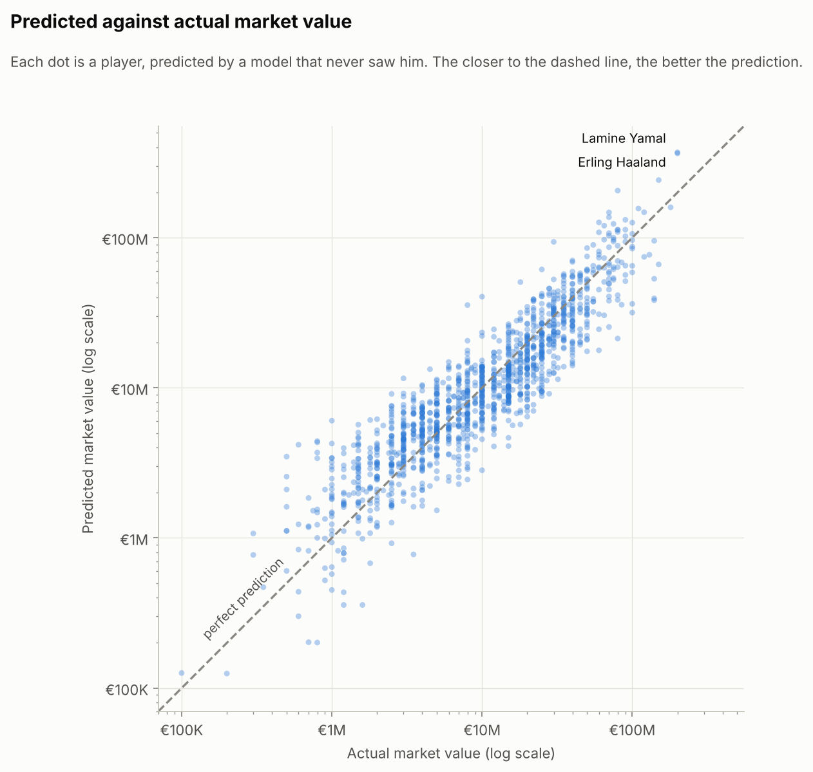

# Football Players Market Value Predictor

Can a few simple statistics explain how much a football player is worth?

This project trains a **linear regression** model that predicts a player's
market value from their performance and profile, then compares the prediction
with the player's actual market value to spot who looks over- or under-valued.

**Result in one line:** goals, assists, minutes, age and position explain about
half of the differences in (log) market value, and the typical prediction is
still off by 63% of a player's real value. That is a real signal, but far from a
pricing tool, and the interesting part is *where* the model disagrees with the
market (see [Predicted vs actual value](#predicted-vs-actual-value)).

**Contents:** [Data](#data-sources) ·
[Quick start](#getting-started) · [Exploratory analysis](#exploratory-analysis) ·
[Model and results](#model-and-results) ·
[LLM reports](#llm-scouting-reports) · [Limitations](#limitations) ·
[Possible improvements](#possible-improvements)

## Approach

| | |
|---|---|
| **Features** | goals, assists, minutes played, age, position |
| **Target** | market value (EUR) |
| **Model** | linear regression (scikit-learn) |
| **Scope** | top 5 European leagues, 2025-26 season |
| **Stack** | Python, pandas, scikit-learn, matplotlib |

An LLM is used on top of the model to turn its numbers into short, readable
scouting reports. It only comments on the model's output; it never makes the
prediction itself.

## Data sources

- **[football-data.org](https://www.football-data.org/)** (free plan): goals,
  assists, date of birth and position. The API only lists players who scored
  at least one goal in the season, so the dataset is limited to those players.
- **[Transfermarkt public dataset](https://github.com/dcaribou/transfermarkt-datasets)**:
  market value and minutes played, which the free plan of football-data.org
  does not provide. The market value is each player's latest valuation at the
  end of the season.

The two sources share no identifier, so players are matched on their name and
date of birth, among the players who appeared in the same league. About 99% of
the players are matched; the others are listed in a report instead of being
dropped silently.

## Project structure

```
├── src/football_value/
│   ├── config.py                # Paths, constants, settings read from .env
│   ├── football_data_client.py  # API client: disk cache + rate limiting
│   ├── collect.py               # 1. player statistics from football-data.org
│   ├── transfermarkt.py         #    Transfermarkt loading helpers
│   ├── matching.py              #    player matching across the two sources
│   ├── merge.py                 # 2. join the two sources
│   ├── features.py              # 3. cleaning and feature engineering
│   ├── eda.py                   # 4. exploratory charts
│   ├── model.py                 # 5. training, evaluation, predictions
│   ├── visualize.py             # 6. result charts
│   ├── pipeline.py              # runs steps 1 to 6
│   ├── scouting.py              # LLM scouting reports (optional)
│   └── plotting.py              # shared chart style
├── tests/                       # Unit tests (no network needed)
├── data/
│   ├── raw/                     # Cached API responses and downloads (not versioned)
│   └── processed/               # Cleaned datasets and predictions (not versioned)
├── reports/
│   ├── figures/                 # Charts (versioned)
│   ├── metrics.csv              # Test metrics of the three models
│   └── coefficients.csv         # Coefficients of the linear model
├── .env.example                 # Template for the required environment variables
├── requirements.txt             # Pinned runtime dependencies
└── pyproject.toml               # Package metadata and tool configuration
```

## Getting started

Requires Python 3.11 or newer.

```bash
git clone https://github.com/Ofilhi/football-market-value-ml.git
cd football-market-value-ml

python -m venv .venv
source .venv/bin/activate        # Windows: .venv\Scripts\activate

pip install -r requirements-dev.txt
pip install -e .
```

Then create your own `.env` file:

```bash
cp .env.example .env
```

| Variable | Purpose |
|---|---|
| `FOOTBALL_DATA_API_KEY` | football-data.org token ([free registration](https://www.football-data.org/client/register)) |
| `LLM_API_KEY` | key of the LLM provider |
| `LLM_BASE_URL` | OpenAI-compatible endpoint of the LLM provider |
| `LLM_MODEL` | model used for the scouting reports |

The `.env` file is ignored by git, so your keys never leave your machine.

## Usage

Run the whole pipeline (steps 1 to 6 below) with one command:

```bash
python -m football_value.pipeline
```

The first run is slower (it downloads about 55 MB and respects the API rate
limit); the next ones take about ten seconds because everything is cached. The
results are reproducible: the random seed is fixed, and a second run gives
exactly the same metrics and charts.

Or run the steps one by one, to see what each of them does.

**1. Collect** the players' statistics from football-data.org:

```bash
python -m football_value.collect
```

This sends one request per league, caches the raw responses in
`data/raw/football_data/` and writes `data/raw/football_data_players.csv`.
Running it again reads the cache instead of calling the API.

**2. Merge** the market values and minutes played from the Transfermarkt dataset:

```bash
python -m football_value.merge
```

This downloads the dataset once into `data/raw/transfermarkt/` (about 55 MB)
and writes `data/processed/players_merged.csv`, plus
`data/processed/unmatched_players.csv` for the players that could not be matched.

**3. Clean** the data and build the model-ready dataset:

```bash
python -m football_value.features
```

This writes `data/processed/players_features.csv`, with one row per player:
the five features and the market value. The cleaning steps are:

- missing assists are set to 0 (the API leaves the field empty instead of 0);
- positions are grouped into Attack, Midfield and Defence;
- players whose market value was last updated before the season are removed;
- a player who changed league mid-season gets a single row with summed statistics;
- age is computed at the end of the season.

**4. Explore** the data and produce the charts shown below:

```bash
python -m football_value.eda
```

## Exploratory analysis

The dataset holds **1,366 players** from the top 5 European leagues.

**1. The target is heavily skewed.** Half of the players are worth less than
€10M while a few stars reach €200M. On a log scale the distribution becomes
almost symmetric (skewness 3.0 → -0.2), so the model predicts the logarithm of
the market value.


**2. Age is the strongest single signal.** Value stays high until about 27
and then drops steadily. Goals, assists and minutes each have a moderate
positive link with value.


**3. Position barely matters, the league does.** The three positions share the
same median value (€10M). The league is not one of the model's features, yet
the median Premier League player is worth €25M against €6M to €9M elsewhere:
a known blind spot of this model.


**4. The features are only mildly correlated with each other** (0.36 at most),
so the regression coefficients can be interpreted without much trouble.


## Model and results

**5. Train and evaluate** the models:

```bash
python -m football_value.model
```

**Method**

- The players are split once into a training set (80%, 1,092 players) and a
  test set (20%, 274 players) with a fixed random seed. All the numbers below
  are measured on the test set, which the models never saw.
- The model predicts the logarithm of the market value; predictions are
  converted back to euros before the errors are measured.
- Numeric features are standardised and the position is one-hot encoded
  inside a scikit-learn pipeline, so the preprocessing is learned from the
  training set only (no data leakage).
- Three models are compared: a **baseline** that gives every player the same
  typical value, the **linear** regression on the five features, and an
  **extended** variant that adds the league and age squared.

**Results on the test set**

| Model | Typical error (% of real value) | MAE | RMSE | R² (log scale) |
|---|---|---|---|---|
| Baseline | 73% | €15.6M | €28.9M | 0.00 |
| **Linear (5 features)** | **63%** | **€11.5M** | **€20.5M** | **0.49** |
| Extended (+ league, age²) | 49% | €11.1M | €30.9M | 0.63 |

Five simple statistics explain about half of the differences in (log) market
value. That is a real signal, but far from a pricing tool: the typical
prediction is still off by 63% of the player's real value.

Adding the league and age squared helps most players (typical error down to
49%), but the RMSE gets worse. One prediction is responsible: the extended
model values Erling Haaland at about €600M instead of €200M. A model trained
on logarithms multiplies its effects, so a player who is extreme on several
features at once gets an explosive prediction once converted back to euros.

**What drives the value** (linear model)

| Feature | Effect on market value |
|---|---|
| Age | -48% for 4.2 more years |
| Goals | +38% for 3.5 more goals |
| Minutes played | +35% for 806 more minutes |
| Assists | +29% for 2.2 more assists |
| Defender | +27% compared with an attacker with the same statistics |
| Midfielder | +26% compared with an attacker with the same statistics |

Numeric effects are given for one standard deviation of the feature, which
makes them comparable: age weighs more than any performance statistic. The
position effect is a reminder of how coefficients read: a defender is not
worth more than an attacker in general, but a defender who scores and assists
as much as an attacker is.

The full tables are in [`reports/metrics.csv`](reports/metrics.csv) and
[`reports/coefficients.csv`](reports/coefficients.csv).

## Predicted vs actual value

**6. Produce** the result charts:

```bash
python -m football_value.visualize
```

Every prediction shown here was made by a model that did not see the player
during training (the test set, plus cross-validation for the training set).

**The model finds the order of magnitude, but stays cautious.** Cheap players
are predicted too high and stars too low: with only five features, predictions
stay close to the average.



**The errors are balanced overall, but not across leagues.** Premier League
players are predicted about twice too low, because the league is not a
feature of the model.


**Where the model and the market disagree the most.** These lists say as much
about the model as about the market:

- the players the model rates *higher* are mostly veterans: a straight-line
  age effect cannot follow how fast value collapses after 30;
- the players the model rates *lower* are stars of top clubs, often defenders
  or holding midfielders, whose value does not show in goals and assists.


## LLM scouting reports

An LLM turns the model's numbers into readable text. It needs `LLM_API_KEY`
in your `.env` file.

```bash
python -m football_value.scouting player "Vedat Muriqi"
```

writes a short scouting note on one player: his season in numbers, what the
model thinks he is worth compared with the market, and the most likely reason
for the gap. A part of the name is enough ("Muriqi").

```bash
python -m football_value.scouting model
```

writes a plain-language summary of the regression: what it does, how accurate
it is, which features matter most and what it cannot see.

**How the LLM is kept honest**

- It never predicts anything: it only comments on numbers the pipeline already
  computed.
- It receives those numbers as a JSON document, together with the model's known
  weaknesses (no league, straight-line age effect, cautious predictions), so it
  can say when a gap is a blind spot of the model rather than a bargain.
- It is instructed to use only the facts provided, not its own memory of
  transfers, injuries or trophies.

**Examples** (generated with the Gemini API; the wording changes from one run
to the next, the numbers do not):

> *Vedat Muriqi recorded an exceptional campaign for RCD Mallorca in La Liga,
> totaling 23 goals and one assist across 3,137 minutes played. Among attackers,
> his goals and playing time both rank in the 99th percentile, whereas his
> assists sit in the 51st percentile. The statistical model estimates his
> valuation at €32,974,000, which is 7.33 times higher than his actual
> Transfermarkt market value of €4,500,000. This massive disparity is driven by
> known model limitations: because the linear regression applies a straight-line
> age effect, it systematically overvalues players over 30, such as Muriqi at age
> 32.2. [...] Ultimately, this valuation gap is far more likely a blind spot of
> the model than a real market inefficiency.*

> *Rodri's 2025-26 season statistics show he has recorded 1 goal and 0 assists
> across 1514 minutes played. [...] While his current market value is 50,000,000
> EUR, the linear regression model predicts a significantly lower valuation of
> 3,527,000 EUR, representing only 7% of his market price. This substantial gap
> exists because the model relies exclusively on basic offensive output, age, and
> position, failing to account for defensive contributions, passing quality, or
> reputation. [...] this gap is more likely a blind spot of the model rather than
> a real market inefficiency.*

I checked the numbers of these texts against the data, but the quality of the
generated text is not evaluated systematically.

**Choosing the provider.** Any OpenAI-compatible endpoint works: change
`LLM_BASE_URL` and `LLM_MODEL` in `.env`. The default is the free tier of the
Google Gemini API, which has two practical constraints:

- **Rate limits are strict and differ per model.** At the time of writing,
  `gemini-3.1-flash-lite` (the default) allows 15 requests per minute and 500 per
  day, while `gemini-3.8-flash` allows only 5 per minute and 20 per day. Check
  your own limits in Google AI Studio. The client does not retry automatically,
  so a failed call does not burn more of your quota.
- **Models get retired.** If you get a `404` saying a model is no longer
  available, list the current ones and pick another:

```bash
curl -s https://generativelanguage.googleapis.com/v1beta/openai/models \
  -H "Authorization: Bearer $LLM_API_KEY"
```

## Limitations

Read the results with these in mind:

- **Only players who scored are included.** football-data.org lists scorers
  only, so there is no goalkeeper and few defenders or midfielders who never
  scored. The model says nothing about those players, and the position effect
  is estimated on a biased sample.
- **One season of statistics against a career-long value.** A market value
  reflects potential, reputation and contract, not only the last season.
- **Assists are noisy.** The two sources agree on assists for only 74% of the
  players who have some; football-data.org's figures are used.
- **The model is deliberately simple.** The age effect is a straight line (it
  rises then collapses in reality), there are no interactions, and the league is
  not a feature, so Premier League players are predicted about twice too low.
  Predictions also stay close to the average: cheap players are predicted too
  high and stars too low.
- **The extended model is fragile at the top.** Its log-scale fit is better, but
  it values Haaland at about €600M instead of €200M.
- **Small test set.** The metrics come from 274 players. A 5-fold
  cross-validation gives similar log-scale R² (0.49 for the linear model, 0.61
  for the extended one), which suggests the split was not unlucky, but the
  figures are not precise to the second decimal.
- **Matching is imperfect.** 12 of the 1,401 players (0.9%) could not be matched
  across the two sources and are dropped; about a tenth of the others were
  matched by a looser rule (same birth date and a shared name part, or same name
  only). As a check, goal counts agree with Transfermarkt's for 98.6% of the
  matched players, loosely matched ones included.
- **LLM texts are not deterministic** and depend on a free-tier external service.

## Possible improvements

- **Rebuild the dataset from Transfermarkt's appearances table**, which covers
  every player including goalkeepers and non-scorers, to remove the biggest
  limitation above.
- **Add the league and a curved age effect to the main model**, as the
  exploratory analysis suggests, and handle the extreme predictions (for example
  with a regularised regression such as Ridge).
- **Use per-90-minute statistics and several seasons** to separate current form
  from long-term level.
- **Try non-linear models** (gradient boosting) as a comparison, keeping the
  linear model as the interpretable reference.
- **Add richer statistics** (expected goals, passing, defensive actions) which
  football-data.org only offers in paid add-ons.
- **Report uncertainty**, with prediction intervals instead of a single value.
- **Evaluate the LLM texts**, for example by automatically checking that every
  number quoted appears in the data it was given.

## Development

```bash
pytest          # run the tests (73, none needs the network)
ruff check .    # lint
```
